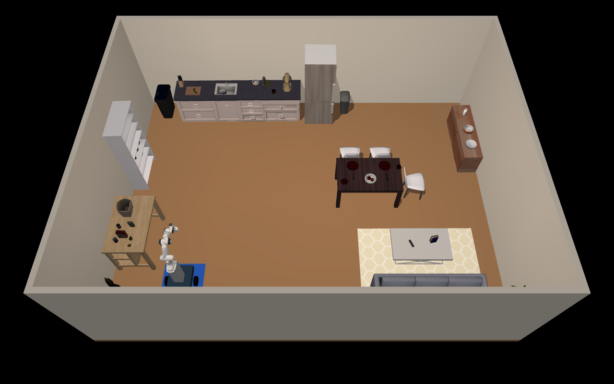

# 移动 Panda 仿真 ROS 2 接口

在 MuJoCo 中加载一台**差速底盘 + Franka Panda** 的移动机械臂和一个住宅场景（厨房 + 餐厅 + 客厅），通过 ROS 2 开放控制和感知接口，供学生编写 Agent。附带技能库：传统方法的抓取、放置、开关抽屉和柜门，以及两个用强化学习训练的技能。

## 交付内容

| 内容 | 位置 |
|---|---|
| 机器人 URDF 与网格 | `ros2_ws/src/mobile_panda_description/` |
| launch：只加载场景并建立话题 | `ros2_ws/src/mobile_panda_bridge/launch/simulation.launch.py` |
| ROS 2 桥接节点、示例客户端 | `ros2_ws/src/mobile_panda_bridge/` |
| 仿真模型和场景 | `mobile_panda_sim/mj/`、`assets/mujoco_kitchen/` |
| 技能库 | [skills/README.md](skills/README.md) |
| 强化学习训练 | [training/README.md](training/README.md) |
| 接口说明 | [docs/ros2_interface.md](docs/ros2_interface.md) |
| 仿真模型说明 | [docs/mujoco.md](docs/mujoco.md) |

主要话题（命名空间 `/mobile_panda`）：

| 方向 | 话题 | 类型 |
|---|---|---|
| 机械臂控制 | `/mobile_panda/arm_joint_delta` | `std_msgs/Float64MultiArray`（7 个关节增量，rad） |
| 夹爪控制 | `/mobile_panda/gripper` | `std_msgs/Float64`（每指开口，m） |
| 底盘速度控制 | `/mobile_panda/cmd_vel` | `geometry_msgs/Twist`（`linear.x`、`angular.z`） |
| RGB 图像 | `/mobile_panda/base_camera/rgb`、`/mobile_panda/hand_camera/rgb` | `sensor_msgs/Image`（rgb8） |
| 底盘位姿 | `/mobile_panda/base_pose` | `geometry_msgs/PoseStamped`（`map` 坐标系真值） |
| 关节状态 | `/mobile_panda/joint_states` | `sensor_msgs/JointState` |
| 机器人模型、TF | `/robot_description`、`/tf`、`/tf_static` | URDF / TF 树 |

另有相机内参、状态 JSON、场景布局、stop/reset 服务，见接口说明。

launch 启动后加载场景、发布话题，然后等待命令：**不执行任务，也不推进物理时间**，直到收到控制命令。

## 场景

约 8 m × 6 m 的住宅：带抽屉的厨房台柜、冰箱、餐桌椅、储物架、玄关台、沙发茶几等，42 个可以拿起的物品。



场景没有任务逻辑和成功判据，任务由 Agent 或任务书定义。物品和家具的位置、抽屉和门的开合程度在 `/mobile_panda/state`，家具占地范围在 `/mobile_panda/scene_info`。起点可以用 `start_x`、`start_y`、`start_yaw` 改。

两种底盘（launch 参数 `base`）：

| `base` | 底盘运动方式 |
|---|---|
| `wheels`（默认） | 自由根 + 左右驱动轮，靠轮胎摩擦行驶；前后为低摩擦支撑球 |
| `planar` | 根固定，x/y/yaw 虚拟关节；轮子只是外观 |

## 环境要求

- Ubuntu 24.04 + ROS 2 Jazzy
- Python 3.10 以上（24.04 自带 3.12），依赖见 `requirements.txt`
- 支持 OpenGL 的显卡。无窗口渲染用 EGL。训练时有 GPU 更快，但不是必须的

## 安装

```bash
git clone <本仓库地址> mobile-panda-agent
cd mobile-panda-agent

# 1. Python 环境和 Panda 模型（约 36 MB）
python3 -m venv .venv
.venv/bin/pip install -r requirements.txt
.venv/bin/python scripts/download_menagerie.py

# 2. ROS 2 工作区
source /opt/ros/jazzy/setup.bash
cd ros2_ws && colcon build --symlink-install && cd ..
```

## 启动

在仓库根目录：

```bash
source /opt/ros/jazzy/setup.bash
source ros2_ws/install/setup.bash
ros2 launch mobile_panda_bridge simulation.launch.py                # 打开 MuJoCo 窗口
ros2 launch mobile_panda_bridge simulation.launch.py viewer:=false rviz:=true
ros2 launch mobile_panda_bridge simulation.launch.py base:=planar start_x:=0.0 start_y:=0.0 start_yaw:=0.0
```

不在仓库根目录启动时，加 `project_root:=/path/to/mobile-panda-agent`，或设置环境变量 `MOBILE_PANDA_ROOT`。launch 优先用仓库里的 `.venv`，日志里会打印用的是哪个解释器；要换时用 `sim_python:=...` 或 `MOBILE_PANDA_SIM_PYTHON` 指定。

检查接口（另开终端，launch 运行中）：

```bash
source /opt/ros/jazzy/setup.bash && source ros2_ws/install/setup.bash
ros2 run mobile_panda_bridge teleop_check
```

它会接收所有传感器话题，然后让底盘前进、转向，动一个关节，开合夹爪，并检查位姿和关节状态有没有响应，最后输出 `"passed": true`。

只看 URDF（不启动仿真）：`ros2 launch mobile_panda_description display.launch.py base:=wheels`

## 技能库

每个技能能做和不能做的事见 [skills/README.md](skills/README.md#适用范围)。

```bash
.venv/bin/python scripts/demo_manipulation.py all --viewer      # 传统方法：抓放物品、开关抽屉和冰箱门
.venv/bin/python scripts/demo_rl_skills.py                      # 强化学习：开到玄关台，拿起物体，放到指定位置
```

技能目前通过 Python 调用，**还没有接到 ROS 话题上**；学生的 Agent 通过 ROS 控制机器人。

## 修改模型

不要直接改生成的 URDF，改 `mobile_panda_sim/geometry.py`（尺寸、相机位置）或 `scripts/build_description.py`（连杆结构），然后：

```bash
.venv/bin/python scripts/build_description.py
.venv/bin/pip install pytest
env -u PYTHONPATH .venv/bin/python -m pytest tests -q
```

## 已知限制

- 轮式底盘的前后支撑是低摩擦球，不是带转向轴的万向轮；质量、惯性、摩擦是仿真初值，未做实机辨识。
- 轮式底盘的支撑球离地 1 mm，车身有约 0.25° 的翘动。
- 住宅场景的数据是转换好的，仓库里没有重新生成它的工具。
- 没有障碍物地图话题；家具占地范围在 `/mobile_panda/scene_info`。
- 技能只能在 Python 里调用，还没有接到 ROS 话题上。
- RViz 加载 `.glb` 网格时日志里没有报错，但还没有人眼确认显示效果。

## 测试环境

所有实测数字都来自 Ubuntu 22.04 + ROS 2 Humble，代码另在 Python 3.12 上测过。**Ubuntu 24.04 + ROS 2 Jazzy 还没有实测**，第一次部署时请跑一遍 `teleop_check` 和测试。

## 来源

- Panda 模型来自 [MuJoCo Menagerie](https://github.com/google-deepmind/mujoco_menagerie)（Apache-2.0），由 `scripts/download_menagerie.py` 下载。
- Panda 网格、`panda_v2.urdf` 和 `panda_v2.srdf` 来自 [ManiSkill](https://github.com/haosulab/ManiSkill)（Apache-2.0）。
- 住宅场景使用 ReplicaCAD（CC BY-NC 4.0，**仅限非商业用途**）和 YCB 物品模型（CC BY 4.0），见 [assets/mujoco_kitchen/ATTRIBUTION.md](assets/mujoco_kitchen/ATTRIBUTION.md)。
